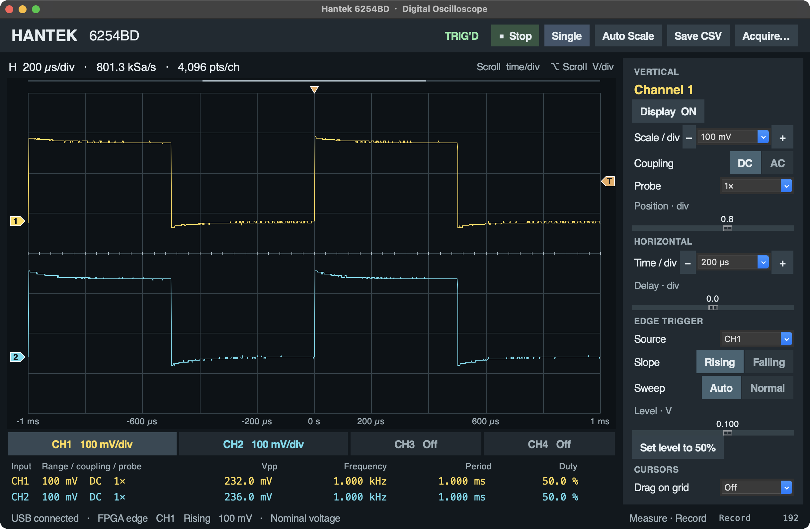

# Hantek 6254BD for Mac

A community oscilloscope application for the Hantek 6254BD. Capture over USB
with FPGA edge triggering, inspect and measure CH1–CH4 records, export CSV, and
save or reopen raw `.hk6254` waveforms. The hardware acceptance record covers
one 6254BD on Apple Silicon macOS. [中文使用与验收](6254BD-使用与验收.md)



## Install · 安装

Use Homebrew on Apple Silicon macOS. The project uses Python 3.13, Tk 9
(touchpad scroll events), PyUSB 1.3.1 and libusb. Run these commands from your
clone or unpacked source release.

```sh
brew install python@3.13 python-tk@3.13 libusb
python3.13 -m venv .scope-env
.scope-env/bin/python -m pip install -r requirements.txt
```

## Run · 开始使用

- **Offline replay, 无设备回放**　Run
  `./Hantek6254BD.command SAMPLE-CH1-CH2.hk6254`. The included trace is a
  captured SAMPLE square wave.
- **Live capture, 实时采集**　Connect the 6254BD over a high-speed USB link.
  Run `./Hantek6254BD.command` or double-click it in Finder. The front panel
  starts in Run mode. Use **Acquire…** to set the physical channel group,
  sample rate and record length. **Single** captures one hardware-triggered
  record. **Save CSV** and **Save record…** export the displayed frame.
- **Hardware checks, 硬件复验**　Close the live window, connect SAMPLE to CH1
  and CH2, and run both checks below.

```sh
.scope-env/bin/python verify_hardware_trigger.py
.scope-env/bin/python verify_acquisition.py
```

The tested maxima per channel are 250 MSa/s and 16,384 points in four-channel
mode, 500 MSa/s and 32,768 points in dual-channel mode, and 1 GSa/s and
65,536 points in single-channel mode. These checks cover waveform capture and
relative timing on the SAMPLE signal. Absolute gain, analog bandwidth and ADC
interleaving accuracy require external references.

## Contributing · 贡献

Include the exact model, macOS/Python/Tk versions, USB connection, channel
group, rate, depth and trigger settings in hardware reports. For a new model,
include a known input signal and actual measurements. A small saved record
can help reproduce problems when you can share the signal data.

Copyright (c) 2026 Michael Rong. Project-owned code is MIT-licensed.
[License](LICENSE) · [Third-party notices](THIRD_PARTY_NOTICES.md)
